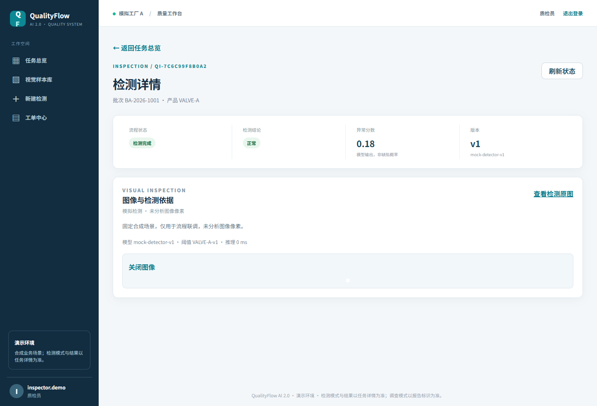
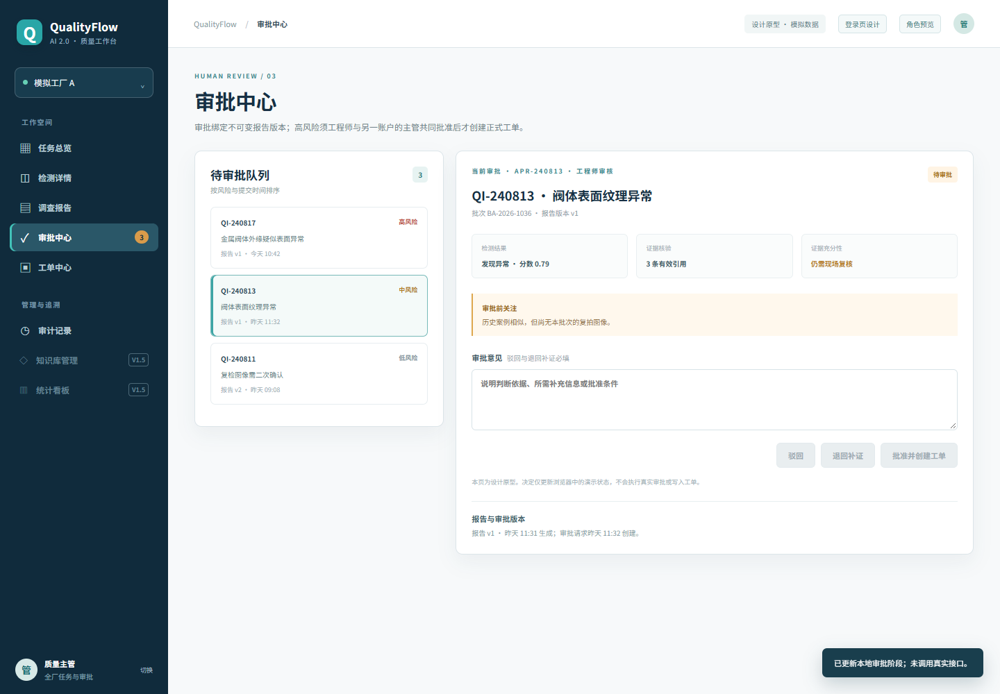
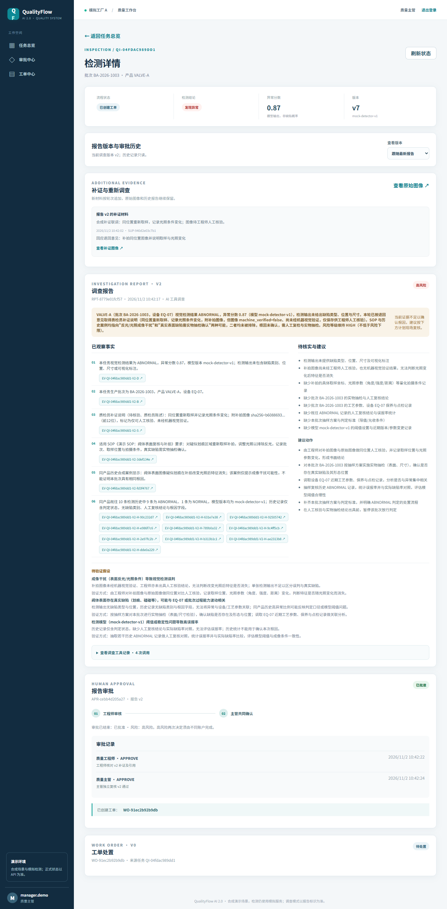
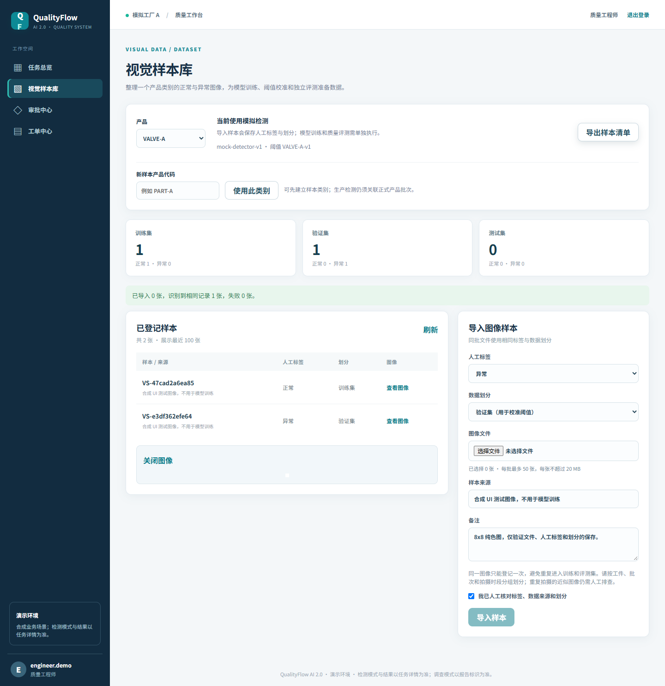

# QualityFlow AI 2.0

> 面向产线质检的「检测 → 调查 → 审批 → 工单」闭环系统。FastAPI + React，
> Anomalib PatchCore 做真实视觉检测，LangGraph Agent + 真实 LLM 完成异常调查，
> 人工审批可跨进程重启恢复。
>
> *A closed-loop quality inspection platform: real PatchCore detection, LLM-driven
> investigation, and resumable human approval.*

| 留出测试集 AUROC | 检测服务吞吐 | 自动化测试 |
| :---: | :---: | :---: |
| **0.972–1.000**<br>MVTec AD 3 类，校准/测试分离 | **21 req/s**<br>16 并发，p95 1.0 s | **74 + 19**<br>后端 / 检测契约 |



## 30 秒看懂

```
上传图像 → 视觉检测 ── NORMAL ────────────────→ 任务完成
                  └─ ABNORMAL / UNCERTAIN → Agent 只读取证
                                              → 结构化报告 + 证据来源
                                              → 工程师 / 主管审批
                                              → 工单 → 处置 → 复检 → 关闭
```

三个不只是 CRUD 的地方：

- **检测结果不可信时不自动放行。** 哈希、模型版本、阈值版本任一不符直接 `ERROR` 转人工；分数落在不确定带 → `UNCERTAIN`，低分不会因为“没超阈值”被判正常。
- **审批暂停是真的暂停。** LangGraph checkpoint 落库，Worker 重启后从人工审批节点恢复；未审批不能创建工单，批准后同一事务只生成一张。
- **每个结论都能追溯。** 报告里的异常分数、模型版本、阈值版本、工具调用与引用资料逐条落库，补证生成 v2/v3，旧版本无法再被审批。

## 关键设计

### 检测契约与阈值治理

Worker 调用独立检测服务（`mock` / `http`），服务端只返回分数和同尺寸定位图；后端重新核对图像哈希、模型与阈值版本，并用共享阈值带自行判定 `NORMAL / ABNORMAL / UNCERTAIN`。`ERROR` 一律转人工，不会伪装成正常。默认仍是 `mock`，PatchCore 服务通过 Compose profile 显式启用。协议见 [视觉检测接入](design/视觉检测接入.md)。

### 持久队列与故障恢复

任务与队列原子写入数据库；Worker 通过领取凭证 + 180 秒租约工作，崩溃后按 2/4 秒退避重试，最多三次，旧凭证提交被拒绝。单 Worker 端到端约 1.9 task/s，瓶颈是领取节奏而不是 GPU——扩容应加 Worker，而不是提高单卡并发。

### Agent 调查与人工审批恢复

`AGENT_MODE=llm` 时 DeepSeek 自主选择四个只读工具（批次、同产品历史、案例、SOP），报告仍须通过服务端校验。实测一次异常任务：3 次模型请求、6 次工具调用、报告证据齐全，但案例/SOP 检索为空时报告如实标注 `evidence_sufficient=false`。审批等待不占用执行凭证，恢复边界见 [Agent 接入与恢复](design/Agent接入与恢复.md)。

### 证据与版本治理

工单只有在最终审批后才存在；退回补证会追加图像与说明并生成报告 v2/v3、重新审批，历史材料与各轮 checkpoint 保留。上传、报告、补证均支持 `Idempotency-Key` 重放。

## 快速开始

```bash
git clone <repo> && cd AnomallyFlow
python -m venv .venv && .venv/bin/pip install -r backend/requirements.txt
.venv/bin/alembic upgrade head
.venv/bin/python backend/init_demo_env.py     # 生成 .env 与演示账户，只需一次
PYTHONPATH=backend .venv/bin/python -m qualityflow.seed
PYTHONPATH=backend .venv/bin/python -m uvicorn qualityflow.api:app --reload
```

另开终端启动 Worker（只起 API 时任务会持久排队）：

```bash
PYTHONPATH=backend .venv/bin/python -m qualityflow.worker
cd frontend && npm install && npm run dev   # http://127.0.0.1:5173/
```

Docker Compose 一次启动 PostgreSQL、API、Worker：

```bash
.venv/bin/python backend/init_demo_env.py
docker compose up --build
```

演示账户 `inspector.demo / engineer.demo / manager.demo / admin.demo / auditor.demo`，密码保存在本地 `.env`（仓库不含默认密码）。API 文档 `http://localhost:8000/docs`。

<details>
<summary><b>可选：真实 PatchCore 检测服务（默认不启用）</b></summary>

`detector/` 实现 [视觉检测接入](design/视觉检测接入.md) 的 HTTP 协议，基线为 Anomalib 2.7 PatchCore，单进程、端口 8080。读取与 Worker 相同的 `DETECTOR_PROFILES_PATH` 和 `detector/models/registry.json`；没有有效配置或模型时返回 `ERROR`。仓库不含权重。

```bash
# 训练 + 校准（无 HuggingFace 时加 --pretrained-source torchvision）
python -m detector.train_patchcore --product-code VALVE-A \
  --normal-dir /data/valve-a/train/good --abnormal-dir /data/valve-a/test/bad \
  --normal-test-dir /data/valve-a/test/good --model-version patchcore-valve-a-1 \
  --threshold-version valve-a-1 --output-dir detector/models \
  --profiles-path data/detector_profiles.json

DETECTOR_DEVICE=cuda TRUST_REMOTE_CODE=1 DETECTOR_PROFILES_PATH=data/detector_profiles.json \
  uvicorn detector.app:app --port 8080

# .env 切换后重启 API / Worker
# DETECTOR_MODE=http
# DETECTOR_URL=http://127.0.0.1:8080/inspect
# DETECTOR_PROFILES_PATH=data/detector_profiles.json
# DETECTOR_API_KEY=<shared-secret>
```

checkpoint 是 pickle 且与 anomalib 版本绑定；更新模型或 profiles 前先让队列清空，已排队任务持有旧版本快照，版本不一致会转人工。验证集很小时分位数阈值会偏保守，可用 `--normal-max/--abnormal-min` 固定演示阈值带（属于演示设置，不是生产校准结论）。完整步骤见 TESTING.md。

</details>

## 测试与评测

```bash
PYTHONPATH=backend .venv/bin/python -m pytest backend/tests -q   # 74 passed
PYTHONPATH=.       .venv/bin/python -m pytest detector/tests -q  # 19 passed，无需 torch
```

| 评测 | 结果 | 复现入口 |
| --- | --- | --- |
| PatchCore 留出集（MVTec bottle / metal_nut / cable） | AUROC 1.000 / 0.997 / 0.972，阈值只由校准集决定 | `detector/evaluate_patchcore.py` |
| 检测服务负载 | 16 并发 21.19 req/s，p95 1.03 s，0 错误 | `detector/benchmark_service.py` |
| 业务链负载 | 单 Worker 约 1.9 task/s；轮询 1 s → 0.1 s 后吞吐 +40% | `backend/benchmark_chain.py` |
| 真实 LLM × 真实检测联合 E2E | 检出 → 调查 → 报告 → 审批 → 工单全链路通过 | TESTING.md |

分层测试方法、逐缺陷明细、复现命令与未覆盖范围见 [TESTING.md](TESTING.md)。

## 边界与未做

- 业务数据全部是合成/教学数据，12 个固定场景；未接入真实产线。
- PatchCore 仅在 MVTec AD 三个类别上做**单次**留出划分评测，没有像素级指标、误报/漏检率、延迟或生产阈值结论；`DETECTOR_MODE` 默认是 `mock`。
- 默认 SQLite 适合本地演示，Compose 提供 PostgreSQL；Redis 与 MinIO 暂未使用，图像存本地 `storage/`。
- Outbox、设备日志检索、完整工单分派与附件、SSE、多 Worker 调度和生产部署仍未实现。

## 文档索引

| 文档 | 内容 |
| --- | --- |
| [TESTING.md](TESTING.md) | 测试分层、真实 LLM 联调、留出集评测、并发基线 |
| [视觉检测接入](design/视觉检测接入.md) | 检测协议、状态判定、进入真实自动检测的条件 |
| [Agent 接入与恢复](design/Agent接入与恢复.md) | 模型配置、审批暂停与 checkpoint 恢复边界 |
| [DeepSeek Harness 接入设计（草案）](design/DeepSeek-Harness接入设计.md) | 可选调查后端、受限工具网关、三段事务与恢复规则；尚未实现 |
| [Agent 对照评测设计（草案）](design/Agent对照评测设计.md) | 冻结案例、A/B 控制变量、调查质量与成本指标；尚未执行 |
| [组件与接口规格](design/组件与接口规格.md) | API、数据模型与状态机 |
| [业务规则决策](design/业务规则决策.md) | 两阶段审批、复检与补拍规则 |



<details>
<summary>更多界面</summary>




</details>
