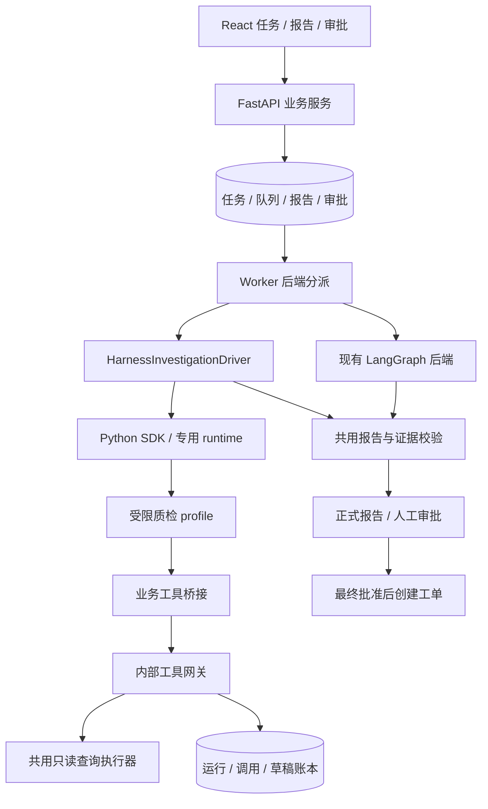

# DeepSeek Harness 接入设计 D0.1

状态：设计草案，尚未实现。更新：2026-11-05。

应用基线：[AnomallyFlow a348b8b262fa](https://github.com/Pengzhan-debug/AnomallyFlow/tree/a348b8b262fa9186f33ad05621037215ec28c4d7)。上游参考：[DeepSeek Harness fcc0ad462172](https://github.com/deepseek-ai/deepseek-harness/tree/fcc0ad462172522aaf5c93a7b2e01f6b9f0b0159)。这两个提交用于设计核查，后续实现须另行冻结已通过验证的 SDK、runtime wheel、插件和模型路由版本。本次不改变默认 Agent 后端、不安装 SDK、不调用模型、不迁移既有审批任务。

## 1. 目标与交付边界

增加可选的 DeepSeek Harness 调查后端，与现有 LangGraph 调查后端共用工具业务逻辑、报告契约、证据核验和审批/工单服务。允许在相同案例上比较两种运行方式，验证调查质量、成本和恢复行为。

Harness 负责模型与工具的调查循环、上下文和会话；服务端负责身份、调用预算、事实来源、风险约束和正式业务状态。模型只提交待审核报告草稿，工单仍由最终审批业务事务创建。

P0 包括：后端选择快照、受限 Harness profile、只读工具网关、草稿提交、执行隔离与结果防重、故障处理、对照评测入口。多智能体、任意代码执行、资料自动写回、自动确认根因、长期记忆和设备控制不属于本阶段。

## 2. 当前实现与需要调整的地方

| 当前实现 | 新后端的处理 |
| --- | --- |
| PipelineJobRow.mode 为 mock / llm | 保留模式含义，新增 agent_backend=langgraph / deepseek_harness；mock 使用现有模拟路径 |
| agent_graph.py 在事务绑定 saver 中执行 agent/tools 节点 | 现有 LangGraph 后端沿用；Harness 调查采用独立驱动，避免在原节点事务内等待工具 HTTP 回调 |
| run_claim() 锁住队列行后执行管线并提交 | Harness 分支在长任务前结束数据库事务，最后以租约凭证和版本条件提交结果 |
| ReadOnlyTools 直接读数据库并记录工具日志 | 抽取共用查询执行器，网关记录本次运行的独立调用账本，接纳报告时再关联正式工具轨迹 |
| LangGraph interrupt 等待人工审批 | LangGraph 原有恢复保留；Harness 会话在提交草稿后结束，正式审批等待由业务队列状态表达 |
| 退回后按报告版本创建新图 | 新报告版本创建独立 Harness session/run，旧报告、材料、审批继续保留 |

关键约束：不能把 harness.run() 直接放进现有持有队列/任务行锁的事务节点，再让其通过另一个连接执行工具 API。回调中的外键写入、版本检查或行锁可能阻塞，而父进程又在等待回调，形成互相等待。新路径使用下述三段式执行，原后端的事务语义不隐式改变。

## 3. 架构与模块职责

拟新增模块（路径为实现建议，尚未创建）：

| 模块 | 职责 |
| --- | --- |
| backend/qualityflow/agent_backends/base.py | 统一调查输入、草稿候选和运行结果；不承诺不同框架的内部 checkpoint 等价 |
| backend/qualityflow/agent_backends/harness.py | SDK 生命周期、运行绑定、预算、事件归档和错误映射 |
| backend/qualityflow/agent_gateway.py | 内部身份校验、调用防重、工具与草稿接纳 |
| backend/qualityflow/agent_runs.py | 短事务状态转移和执行凭证检查 |
| integrations/deepseek_harness/ | 固定版本的 profile、工具插件/桥接、依赖锁和契约探针 |
| backend/agent_eval.py | 运行相同冻结案例，输出统一对照记录 |

业务 API 不直接暴露 Harness 管理端。P0 每个活跃 run 使用专用子进程和运行目录；一个进程一次承接一个任务。后续只有在租户、会话和插件隔离实测通过后才考虑进程池。

## 4. 后端选择与版本快照

新增配置 AGENT_BACKEND，默认 langgraph。只有 mode=llm 的新任务使用该选择。任务入队时将后端写入 PipelineJobRow；配置变化不改变已排队或待审批任务的后端。

每个报告版本另存 runtime_config_snapshot：后端、SDK/runtime 版本、profile 与工具定义哈希、报告契约版本、业务提示词版本、模型路由/解析后的模型 ID、推理参数、预算和网关契约版本。凭据只通过受控环境或 SDK 参数传入，不进入快照。

首次创建任务时固定后端及运行配置；同任务退回后的新报告版本沿用该后端，记录本轮配置快照。更换后端的对照实验创建独立任务；P0 不支持待审批任务原地切换。

现有 LLM_BASE_URL 使用 Anthropic 兼容协议，不能直接将 /anthropic 地址交给默认 DeepSeek SDK 路由。实现时验证 SDK 的 provider/base_url/model 配置，确认实际解析后的模型与原后端对应；不在此草案中填写密钥或假定模型别名永久可用。无法选到同一模型版本的实验须标记不可严格比较。

## 5. 调查输入、工具与报告契约

### 5.1 服务端输入

InvestigationContext 由服务端生成，包含 task_id、tenant_id、report_version、run_id、产品、批次、检测结果、风险下限和已授权初始证据。备注、文档和上版报告均标为待核验输入。

模型不得决定租户、任务身份、报告版本、服务地址或执行凭证。模型可见上下文不是授权依据；服务端从 run 绑定重新读取这些字段。

### 5.2 模型可用工具

| 工具 | 模型参数 | 行为 |
| --- | --- | --- |
| get_batch_info | 空对象 | 仅查当前任务批次 |
| get_inspection_history | limit，可选 1–10 | 当前产品、任务创建时间之前的历史 |
| search_quality_cases | query、可选 limit | 当前租户/产品适用案例 |
| search_sop_documents | query、可选 limit | 当前租户/产品且当前有效的 SOP |
| submit_report | ReportDraft | 只提交草稿；不审批、不建工单 |

模型参数根对象禁止额外字段，query 为 2–256 字符。历史查询默认 limit=5。P0 沿用至少三种不同只读工具的业务规则；规则满足不代表选择正确，能力评分另行定义。

工具桥接可由 Cordis 自定义插件调用内部网关，或由受控 MCP server 包装相同网关。P0 选一种实现后冻结，不同时保留多条语义不同的通路。profile 的实际模型可见工具清单必须恰好为上述五种（允许稳定前缀映射到规范名）；不挂载 shell、文件、浏览器、团队、任意网络请求和额外资源工具。启动探针发现额外工具时拒绝启动任务。

### 5.3 内部工具网关

以下为拟新增的内部接口，不是当前已存在路由：

- POST /internal/v1/agent-runs/{run_id}/tool-calls
- POST /internal/v1/agent-runs/{run_id}/drafts

请求使用短期运行凭据，经部署层认证后再核对 run 绑定；不复用管理员或工程师登录 token。凭据绑定 run、租户、任务、版本、领取凭证、作用域和到期时间，存储仅保留凭据哈希。每次调用检查 run 有效、队列领取凭证仍匹配、租约和总预算尚未过期。

工具请求体为 call_id、tool_name、arguments。返回保留现有 status/data/evidence/error_code/elapsed_ms 结构，增加 invocation_id。业务错误使用明确错误码，EMPTY 保持空结果，模型不得将其转述为已查到事实。

(call_id, run_id) 唯一。同调用 ID 同参数返回已提交快照；同 ID 换参数 409。不同 ID 的重复查询计入预算。并发重复到达时用短事务和唯一约束协调，一次执行者写结果，另一请求等待已有结果或收到可重试的“进行中”，不双执行。超时后只有相同调用 ID 的安全重放可以复用结果；不得把未知状态自动算作成功。

工具查询只读业务表，运行账本和审计允许写入。网关内部短事务可以核对并锁定领取状态，完成查询、调用记录和预算扣减后立即提交；不在该事务里等待模型或 Harness。

### 5.4 草稿接纳

[报告 JSON Schema](contracts/agent-report-draft-v1.schema.json) 对齐当前 model.py 的 ReportDraft；[设计样例](contracts/agent-report-draft-v1.example.json)只验证格式，其证据 ID 为占位符，不能用于真实发布。

submit_report 仅接收报告正文。run_id、task_id、版本、模型版本、生成时间、证据来源索引和工具轨迹均由服务端补全。自然语言最终回复不作为正式报告入口。

顺序为：Schema → 当前业务规则（风险下限、单图 evidence_sufficient=false、至少三种工具）→ 引用属于本 run 的授权初始证据或已提交工具调用 → 来源任务/租户/版本/有效性校验 → 暂存草稿。来源 ID 正确只证明可定位，不证明自然语言事实被支持。

格式错误返回有界字段错误，最多两次修正；授权、旧版本、风险或来源校验失败进入终止/人工处理，不用自由文本“修好”后静默绕过。草稿暂存成功后终止本轮调查。一次 run 只接纳一个规范化内容哈希；相同内容重放返回原草稿，不同内容提交冲突。

## 6. 三段式 Worker 执行与事务

### 阶段 A：准备并提交

1. 使用现有 claim_job 提交队列领取结果。
2. Harness 专用驱动开启短事务，核对 token/租约/目标版本；完成或读取已提交检测结果，正常/检测错误按现有规则结束，不创建调查会话。
3. 异常或不确定结果生成固定输入快照、AgentRun 和初始证据索引，提交后关闭数据库会话。
4. 启动 Harness 时数据库不持有该任务的长事务行锁。

### 阶段 B：外部调查

SDK 进程只执行受限 profile。工具结果逐调用提交到 AgentCall 账本；草稿暂存在 AgentDraft。该阶段不创建正式 ReportRow、ApprovalRow 或 WorkOrderRow。

运行身份以 run_id + execution_generation 标识，并绑定 job lease token。一个报告版本可以有多个故障尝试，但同一时刻只有一个有效 generation。主进程丢失后，旧凭据失效，其回调与最终结果均被拒绝。

### 阶段 C：校验并发布

重新开启事务锁定 job/任务，检查 token、租约、报告目标版本、run generation 和任务状态。重读草稿及调用快照，执行共用证据校验。

通过后将正式报告、引用、从本 run 导入的工具记录、审批请求、审计和队列 WAITING_APPROVAL 一起提交；正式工具记录以 invocation_id 去重。崩溃重放先查 (task_id, report_version) 是否已发布且绑定同一草稿/run，不重复发布。存在不同来源报告时按冲突处理。

此时 Harness 已结束调查，没有等待审批的外部进程。工程师/主管的决定由现有 API 事务处理；最终决定重新激活队列后，Harness 驱动只读取审批终态并结束，不能再次调查或建工单。

退回补证时新版本创建新 run/session，旧运行不再可写。需调整现有 finish_returned_checkpoint 的后端分派：仅 LangGraph 路径恢复其旧图，Harness 路径检查旧 run 已结束。

### 会话恢复边界

保存 (tenant_id, task_id, report_version, run_id, generation) → (session_id, 隔离 home 标识) 的映射。明确区分 SDK start_session 与 resume_session；恢复使用已记录原 ID、home 和 workspace。

- 同一进程暂时中断、凭据仍有效：可恢复原 session，前提是原运行已确认停止。
- 新 Worker 接手：先使旧 generation 和令牌失效，再按新 generation 建立执行。P0 默认创建新 session；重用持久历史须通过旧进程终止和身份重绑定探针后再开放。
- 草稿已暂存但未发布：先验证并发布该草稿，避免再次调用模型。
- 正式报告已提交：直接恢复到审批业务状态。
- 一次重试的累计模型次数、工具次数和费用不能归零；按报告版本在 run 账本聚合。

Harness JSONL/会话日志不与 SQL 业务结果构成同一事务。设计依靠短事务、运行凭证、持久草稿与发布幂等来协调；不宣称所有外部调用 exactly-once。已提交但未被正式报告接纳的调用仍保留在运行审计中。

## 7. 拟新增持久化字段

| 对象 | 关键字段及约束 |
| --- | --- |
| PipelineJobRow | agent_backend，默认 langgraph；旧行迁移不变更行为 |
| AgentRun | UUID、task/tenant/report_version、generation、claim token 绑定、状态、session/home 标识、配置哈希、累计预算、截止时间、安全错误码 |
| AgentCall | invocation_id、run_id、client_call_id、参数哈希、规范工具名、结果/证据快照、状态、开始/结束时间；unique(run_id, client_call_id) |
| AgentDraft | draft_id、run_id、规范化内容哈希、草稿 JSON、验证状态；unique(run_id) |
| 正式报告关联 | 来源后端、run/draft ID、配置指纹；unique(task_id, report_version) 沿用 |

run 状态建议为 PREPARED → RUNNING → DRAFT_READY → PUBLISHED；终态另含 FAILED / CANCELLED / SUPERSEDED。PUBLISHED 表示报告已进入业务审批，不表示人工已批准。

账本状态与过期检查以数据库为准。原始模型日志按租户受限保存并设保留期，默认对外仅暴露工具目的、执行状态、引用和安全错误摘要，不展示内部推理、凭据或运行目录。

## 8. 执行预算与失败处理

起步预算沿用现有政策：最多 8 次只读工具调用、10 次模型请求、2 次格式修正。P0 每次外部尝试的总墙钟上限 120 秒，包含初始化、工具和 SDK 活动；同报告各故障尝试的累计上限同样为 120 秒，人工审批等待不计入。队列租约 180 秒；不依赖尚未实现的 heartbeat 延长期限。

SDK 的 request_timeout_seconds 只限制协议响应等待，不代表整个 Agent 已停止；外层 supervisor 必须独立计时。达到截止时间后先使 run 能力失效，再请求取消、限时等待退出并清理专用进程；关停后仍到达的事件只进入审计，不得发布。重试前确认没有活跃旧进程，无法确认则转人工。

模型预算通过受控插件的请求准入钩子强制执行，计入重试及附加请求。P0 关闭自动压缩和后台目标续跑；如某类隐藏请求无法观测或拦截，不能进入自动发布路径。调用次数不足以计算费用时成本字段为 null 并注明原因。

| 情况 | 处理 |
| --- | --- |
| 配置/插件/模型不兼容 | HARNESS_NOT_CONFIGURED，任务转人工；无隐式后端回退 |
| 工具越权/未知工具 | 拒绝并审计，禁止产生业务写入 |
| 工具空结果 | 保留 EMPTY，报告列出相应缺失信息 |
| SDK/网络短暂故障 | 撤销旧能力，按既有最多三次尝试政策重试，继承累计预算 |
| 租约失效/新版本替代 | HARNESS_STALE_RUN，旧结果不发布 |
| 预算耗尽/草稿持续错误 | NEEDS_REVIEW，保留错误与调用记录 |
| Harness 权限询问 | P0 只读工具无需交互；额外能力请求拒绝并结束本轮；不是质量审批 |
| 人工质量审批 | 仅由应用工程师/主管账户及业务 API 执行 |

实现前验证：profile 恰好五个工具、一次最小运行/取消/恢复、模型路由映射、请求预算钩子、严格报告提交、运行令牌失效、SDK 退出清理。版本或钩子不满足以上能力时将 Harness 后端保持为不可用状态。

## 9. 实施顺序与验收

1. **统一输入与契约**：保留原后端，增加 backend 快照与表迁移；现有测试全通过。以假 Harness 驱动验证三段事务和审批分派。
2. **网关与运行账本**：复用业务查询逻辑；覆盖越权、版本、调用防重、预算、草稿幂等和 PostgreSQL 回调无长锁阻塞。
3. **SDK/profile 探针**：固定 SDK/runtime/插件版本，验证白名单、取消、会话恢复和预算；只调用合成数据。
4. **真实单任务联调**：同一合成案例完成调查→草稿→校验→审批→工单，并分别在工具提交后、草稿暂存后、正式发布后中断 Worker。
5. **对照评测**：按 [评测设计](Agent对照评测设计.md) 固定模型、数据、业务提示词、工具、预算及计分方法；未达门槛不更换默认后端。

验收不变量：无审批创建正式工单数为 0；重复正式工单数为 0；旧 generation/旧版本写入成功数为 0；超出白名单执行数为 0；已暂存草稿可在重建 Worker 后发布且不重复调用模型。暂不填写新的吞吐、成功率或成本提升数字。

回退：只影响新入队任务的默认选择，切回 langgraph。已绑定 Harness 的任务应完成、取消或转人工，不能直接交给 LangGraph 解释 Harness 会话。回退后账本和历史报告继续可查。

## 10. 官方依据

- [上游 README（开发预览与版本变化）](https://github.com/deepseek-ai/deepseek-harness/blob/fcc0ad462172522aaf5c93a7b2e01f6b9f0b0159/README.md)
- [架构与 profile](https://github.com/deepseek-ai/deepseek-harness/blob/fcc0ad462172522aaf5c93a7b2e01f6b9f0b0159/docs/architecture.md)
- [Python SDK 生命周期、恢复与超时语义](https://github.com/deepseek-ai/deepseek-harness/blob/fcc0ad462172522aaf5c93a7b2e01f6b9f0b0159/python/sdk/README.md)
- [工具注册契约](https://github.com/deepseek-ai/deepseek-harness/blob/fcc0ad462172522aaf5c93a7b2e01f6b9f0b0159/docs/cookbook/adding-a-tool.md)
- [MCP client](https://github.com/deepseek-ai/deepseek-harness/blob/fcc0ad462172522aaf5c93a7b2e01f6b9f0b0159/packages/mcp/mcp-client/README.md)

以上引用用于能力核查，文中内部路由、数据表和项目模块属于拟实施设计，不代表已存在可运行适配器。
