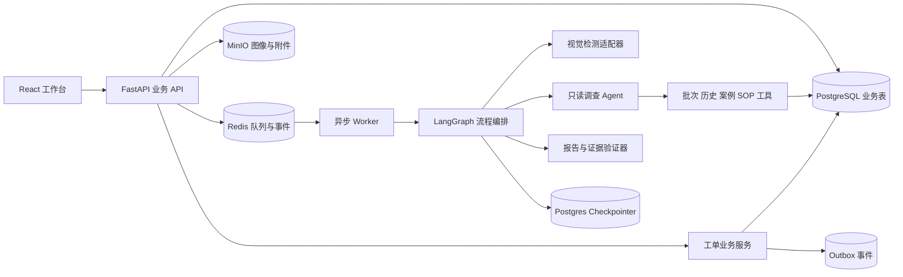
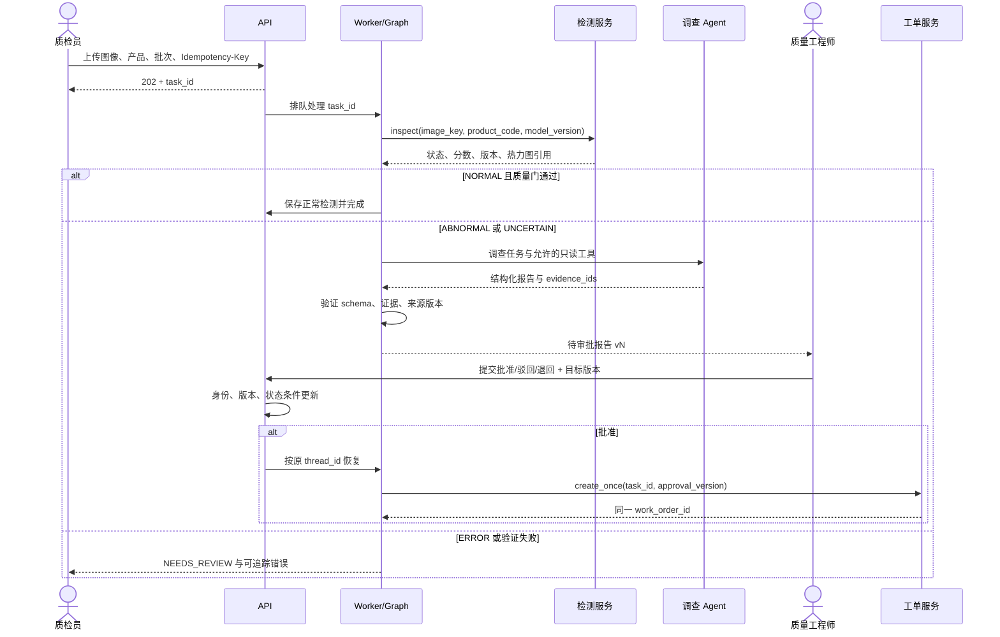

# QualityFlow AI 2.0 系统设计初稿

版本：D0.1，依据《QualityFlow AI 2.0 产品需求文档 PRD V1.0》。这是待评审的实现设计，不表示任何服务已经开发或部署。首轮目标是用可复现模拟数据打通一条完整闭环，再逐步接入真实视觉模型与调查 Agent。

当前实现补充（2026-10-29）：独立 Worker 已采用数据库 `pipeline_jobs` 持久队列，任务和队列一起提交；PostgreSQL 领取时使用行锁与条件更新，180 秒执行期限、凭证校验、最多三次尝试。管线结果与队列完成确认同事务提交，故障时整段回滚重跑。当前队列不依赖 Redis；LangGraph checkpoint、长任务 heartbeat 与 Outbox 仍待实现。实际运行和测试范围见根目录 README 与 TESTING.md。

当前实现补充（2026-10-30）：真实 DeepSeek 调查 Agent、LangGraph 节点 checkpoint 与审批 interrupt/恢复已接入，并完成待审批期间重启 Worker 的真实联调。新模式在节点边界提交进度；历史检测具有独立证据引用。

当前实现补充（2026-11-02）：退回补证、新报告版本、独立 checkpoint 和重新共同审批已实现，并在真实 DeepSeek 与浏览器上通过合成任务联调。视觉样本库和 HTTP 检测适配器已加入，当前环境仍用 Mock；真实模型与阈值尚未训练/校准。长任务 heartbeat 与 Outbox 仍待开发。实际能力与限制见 [Agent接入与恢复](Agent接入与恢复.md)、[视觉检测接入](视觉检测接入.md) 及根目录 TESTING.md。

## 1. MVP 范围与约束

MVP 覆盖上传、四类检测结果、批次和知识检索、结构化调查报告、证据核验、人工审批、幂等创建工单、处置、复检、审计。首轮开发先允许视觉与调查模块使用确定性 Mock，确保无 LLM 时业务链路也成立。

系统只提供辅助调查和流程管理。模型异常分数不是缺陷概率；原因假设不是已确认根因。设备控制、未经审批的停机或报废、跨厂集成和在线模型训练不在 MVP 范围。

## 2. 服务架构

**职责边界**

| 模块 | 负责 | 不负责 |
| --- | --- | --- |
| API | 身份与资源授权、输入校验、查询、提交审批决定、工单命令 | 代替 Worker 做长耗时推理 |
| 检测适配器 | 返回 `NORMAL / ABNORMAL / UNCERTAIN / ERROR` 与模型元数据 | 判定根因或是否放行 |
| Analysis Agent | 在预算内选择只读工具，生成结构化事实、假设和建议 | 直接写工单、改变权限或审批状态 |
| 验证器 | 校验 JSON、证据归属、来源版本和引用一致性 | 推断不存在的证据 |
| LangGraph | 确定性路由、checkpoint、审批 interrupt 与恢复 | 把业务数据库事务交给 LLM |
| 工单服务 | 审批前置校验、幂等创建、状态转移、Outbox 与事件 | 接受模型直接调用的写命令 |

## 3. 关键业务序列

上传成功仅代表任务已创建。检测、调查、审批和工单结果必须通过任务查询或事件流获取；SSE 断线后以正式业务状态为准重新同步。

## 4. 状态机设计

### 4.1 检测任务

| 当前状态 | 允许后继状态 | 触发条件 |
| --- | --- | --- |
| `PENDING` | `VALIDATING`, `CANCELLED` | Worker 领取或授权取消 |
| `VALIDATING` | `DETECTING`, `FAILED` | 图像与批次校验结果 |
| `DETECTING` | `INVESTIGATING`, `COMPLETED`, `NEEDS_REVIEW` | 异常/不确定、可信正常、检测失败 |
| `INVESTIGATING` | `WAITING_APPROVAL`, `NEEDS_REVIEW`, `FAILED` | 报告核验、预算超限或不可恢复故障 |
| `WAITING_APPROVAL` | `ORDER_CREATED`, `REJECTED`, `INVESTIGATING` | 批准、驳回、退回补证后新版本调查 |
| `ORDER_CREATED` | `COMPLETED` | 工单引用保存与流程最终确认 |

每次状态转移由业务层校验，并通过 `version` 乐观锁更新。`COMPLETED / REJECTED / CANCELLED` 的后续动作应创建显式新任务或新调查版本，不能静默覆盖结果。模型错误不得进入 `COMPLETED`。

### 4.2 审批与工单

审批请求限定于一个不可变报告版本。高风险先由工程师批准转入主管阶段，且两人须为不同账户；主管批准后才进入 `APPROVED` 并允许创建工单。任一阶段可驳回或退回补证，决定均须条件更新和审计。`EXPIRED` 只提示处理，不自动批准。旧版本决定返回冲突和最新版本信息。详见 [业务规则决策](业务规则决策.md)。

工单状态为 `OPEN → ASSIGNED → IN_PROGRESS → PENDING_REINSPECTION → CLOSED`。复检无法判断时保持 `PENDING_REINSPECTION`，工程师要求补拍并等待新一轮记录；复检不通过返回 `IN_PROGRESS`，追加返工事件。取消需授权理由。关闭要求已提交且明确通过的复检记录、工程师确认和状态版本匹配。

## 5. 数据设计与不可变记录

`inspection_tasks` 保存任务身份、租户、批次、图像引用、流程状态、`thread_id` 和状态版本。`inspection_findings` 保存检测原始返回及模型/阈值版本。`investigation_reports` 按 `(task_id, report_version)` 唯一且只追加，报告 JSON 保存结构化事实、假设、缺失证据和建议。`evidence_items` 保存来源对象、来源版本、检索时间和租户；`report_evidence` 保存支持、反对或背景用途。

`approval_requests` 绑定不可变 `report_id`，记录审批状态、操作者、时间、意见与版本。`work_orders` 按 `(task_id, approval_id)` 和 `idempotency_key` 建唯一约束。`work_order_events`、`reinspections`、`tool_execution_logs` 和 `outbox_events` 只追加。图像、热力图及附件只在对象存储保存文件内容，业务表保存 key、哈希、类型和尺寸。

**数据库必须保证的关系**：工单的 `approval_id` 指向已批准且对应当前报告版本的审批；工单唯一键防止同一批准版本重复创建；报告引用的证据必须属于本任务和租户。时间统一保存为带时区时间。

## 6. 幂等、恢复与并发

1. 上传接口接收 `Idempotency-Key`，在同一租户和操作者范围内绑定请求指纹。相同键与相同请求返回同一 `task_id`；相同键但不同请求返回冲突。
2. 审批提交带报告版本或 `If-Match`。使用 `WHERE status = 'PENDING' AND version = :expected` 的条件更新；并发或相反决定仅一个成功。
3. Graph 在审批前持久化 checkpoint 并 interrupt。恢复时读取数据库中正式审批结果，按同一 `thread_id` 继续；不信任客户端直接传入的“已批准”字符串。
4. 创建工单使用 `inspection_id + approval_version` 的固定业务键，在同一数据库事务中写入工单和 Outbox。重复执行查得同一工单 ID；提交后 Worker 崩溃仍可安全重放。
5. 外部消费者按 Outbox 事件 ID 去重。业务状态以 PostgreSQL 为准，Redis 与 SSE 仅用于传递进度。

## 7. Agent 与证据契约

首批可用只读工具为 `get_batch_info`、`get_inspection_history`、`search_quality_cases`，并提供 `search_sop_documents`。统一返回 `status / data / evidence / error_code / elapsed_ms`；服务端注入租户及任务上下文，并限制参数、超时、记录数与调用次数。

报告 JSON 至少包含 `defect_summary`、`observed_facts[]`、`hypotheses[]`、`missing_evidence[]`、`recommended_actions[]`、`risk_level`、`evidence_sufficient`、`model_version`、`prompt_version`。每个假设包含支持与反对证据 ID、不确定性和验证计划。验证器拒绝不存在、跨租户、过期或与报告不一致的引用；无证据时保留空结果和工具日志，明确标注证据不足。

工具响应、SOP、日志和用户备注作为业务数据处理，不能改变系统指令、工具权限或审批策略。预算默认 8 次工具调用、累计 120 秒、单工具 15 秒；达到上限时转人工复核。

## 8. API 设计起点

| 接口 | 关键输入/输出 | 关键校验 |
| --- | --- | --- |
| `POST /api/v1/inspections` | multipart 图像、批次、产品；`202 + task_id` | 文件、批次归属、`Idempotency-Key` |
| `GET /api/v1/inspections/{id}` | 检测、状态、报告和工单引用 | 租户与资源授权 |
| `GET /api/v1/inspections/{id}/events` | `event_id / task_id / event_type / timestamp / safe_payload` | 授权、断线后重新同步 |
| `GET /api/v1/inspections/{id}/report` | 不可变报告版本、证据引用 | 授权、版本参数 |
| `POST /api/v1/approvals/{id}/decision` | 决定、意见、报告版本 | 工程师权限、条件更新、高风险规则 |
| `PATCH /api/v1/work-orders/{id}` | 指派或处理命令、目标版本 | 状态转移、角色权限、审计 |
| `POST /api/v1/work-orders/{id}/reinspections` | 复检图像和质检员结论 | 质检员权限、工单状态 |
| `POST /api/v1/work-orders/{id}/close` | 工程师确认、复检 ID、目标版本 | 已通过复检、权限、状态版本 |

错误响应统一 `error_code / message / details / trace_id`。客户端只呈现安全文案，敏感原文、凭据和模型隐藏推理不进入事件流或审计 UI。

## 9. 页面到接口的映射

| 页面 | 数据源 | 主要命令 |
| --- | --- | --- |
| 登录页 | 演示账户说明、会话状态 | 登录、退出；服务端校验身份与角色 |
| 任务总览 | 任务列表、状态汇总 | 新建检测、筛选 |
| 检测详情 | 单任务、检测结果、事件流 | 查看报告、人工重试请求 |
| 调查报告 | 报告版本、证据详情 | 打开来源、进入审批 |
| 审批中心 | 待审列表、当前报告 | 批准、驳回、退回补证 |
| 工单中心 | 工单、事件、复检记录 | 分派、记录处置、提交复检、关闭 |
| 审计记录 | 任务审计、工具摘要 | 筛选和追踪 |

界面设计与交互状态见 [设计说明](设计说明.md)、[第二轮交互规格](第二轮交互规格.md)、[第三轮设计记录](第三轮设计记录.md)、[组件与接口规格](组件与接口规格.md)、[登录页设计](login-prototype.html) 和 [可点击原型](qualityflow-prototype.html)。原型仅演示界面行为，未连接这里定义的接口。

## 10. 首轮实现切片与验证

1. 初始化 FastAPI、PostgreSQL、Redis、MinIO、Worker、前端和 Compose 结构；定义模拟演示账户、单租户与固定种子数据。
2. 建立任务、报告、证据、审批、工单及事件表与迁移。先写状态转移和唯一约束的集成测试。
3. 实现上传、批次校验和可复现视觉 Mock，覆盖四类返回结果。页面能够查询任务状态。
4. 用固定结构化模拟报告打通证据索引与核验，再接入只读工具和 Agent。每条报告引用可回到来源对象。
5. 接入审批 interrupt/恢复、工单幂等事务、处理与复检；验证重复批准、Worker 崩溃恢复和复检失败返工。

首轮验收以 PRD 的 TC-01 至 TC-12 为回归基线。性能目标和正确率只在相应环境中测量后记录为实测值；设计文档中的目标不作为已达成指标。

## 11. 待确认设计决策

- 首个零件类别、批次字段、模拟 SOP 和图像样例的具体内容。
- 高风险共同审批、驳回/退回理由及复检无法判断路径已在 [业务规则决策](业务规则决策.md) 确定。
- 图像与附件的保存周期、报告导出格式和审计可见范围。
- 首轮视觉模型采用确定性 Mock；真实模型接入时再确定阈值校准与不确定判定规则。
